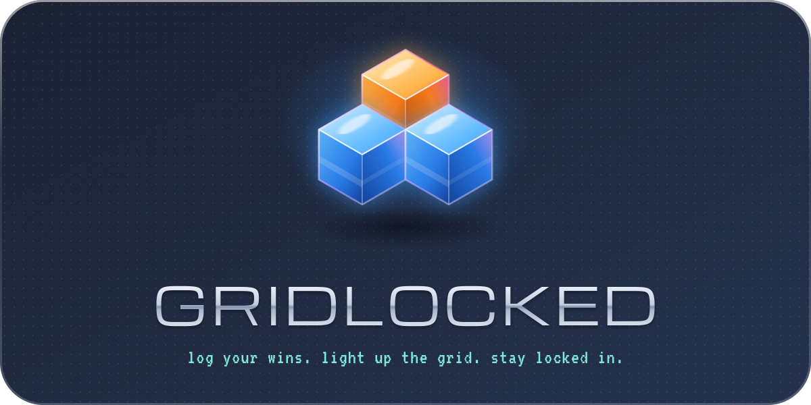
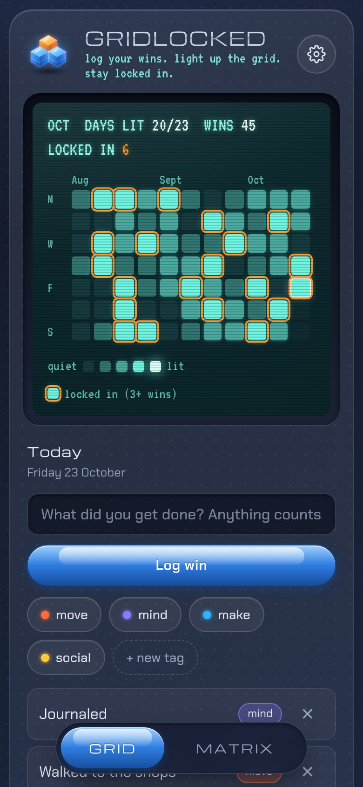
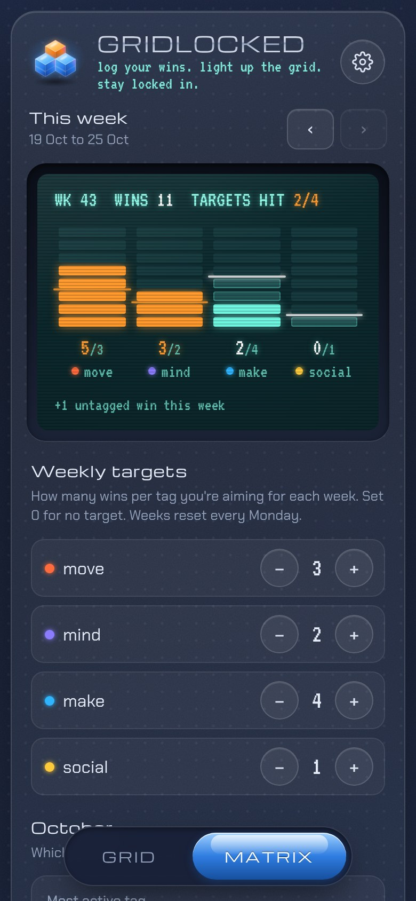
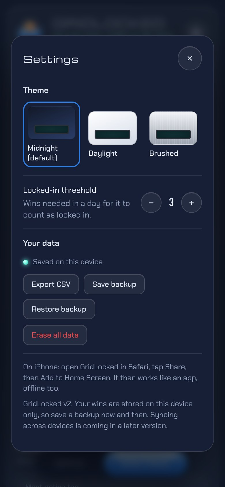

<p align="center">
  <picture>
    <source media="(prefers-color-scheme: light)" srcset="assets/logo-light.svg">
    
  </picture>
</p>

<p align="center">
  A small-wins tracker with a Y2K-meets-modern interface.<br>
  Log anything you got done, watch the grid light up, and lock in your days.
</p>

<p align="center">
  <a href="https://YOUR-USERNAME.github.io/gridlocked/"><b>Open the live app</b></a>
</p>

<table align="center">
  <tr>
    <td></td>
    <td></td>
    <td></td>
  </tr>
</table>

## Why I built this

<!-- Write this part yourself: a few honest sentences on why you made it and what you wanted to learn.
     It's the part people actually read, and it should sound like you. -->

## Features

- **Grid view:** a GitHub-style heatmap rendered as a backlit LCD. Each win brightens that day's pixel, and any day with 3 or more wins gets an orange "locked in" outline.
- **Free-form logging with tags:** log anything ("made a proper breakfast" counts). Tag wins as move, mind, make or social, or create your own tags.
- **Back-dating:** tap any past day to add wins you forgot to log.
- **Matrix view:** set weekly targets per tag, then track them on a retro LED equalizer. Bars turn orange when you hit a target.
- **Monthly insights:** your most active tag and a breakdown of where your wins come from.
- **No streaks, by design:** missing a day costs you nothing. The app rewards showing up, not punishing gaps.
- **Three themes:** Midnight (default), Daylight and Brushed.
- **Your data stays yours:** export to CSV for analysis, or back up and restore as JSON.
- **Installable and offline:** add it to your iPhone home screen and it runs like a native app, with or without signal.

## Install on iPhone

1. Open the live app link in **Safari**.
2. Tap **Share**, then **Add to Home Screen**.
3. Open GridLocked from your home screen. It runs full screen and works offline.

> The home-screen app keeps its data separately from Safari tabs. To move existing wins across, use **Settings → Save backup** in one, then **Restore backup** in the other.

## How it's built

No frameworks and no build step: plain HTML, CSS and JavaScript in a single page.

| Area | Approach |
| --- | --- |
| UI | Hand-written CSS with design tokens, so each theme is just a block of variables |
| Heatmap and equalizer | CSS grid, generated from the data in vanilla JS |
| Storage | `localStorage` behind a small `Store` layer, so a cloud database can replace it without touching the rest of the app |
| Offline | Service worker: network-first for the page, cache-first for fonts and icons |
| Install | Web app manifest, iOS meta tags, safe-area handling for the notch and home bar |
| Logo | SVG generated in Python, with text converted to outlines |
| Accessibility | Keyboard-navigable, labelled controls, respects reduced-motion settings |

### Data model

Each win is stored as:

```json
{ "id": "…", "date": "2026-10-23", "text": "Walked to the shops", "tag": "move", "loggedAt": "2026-10-23T18:04:11Z" }
```

**Export CSV** produces one row per win (`date, tag, win, logged_at`), ready for pandas, SQL or Power BI.

## Run it locally

```bash
git clone https://github.com/YOUR-USERNAME/gridlocked.git
cd gridlocked
python3 -m http.server 8000
```

Then open http://localhost:8000. Serving over http is needed for offline mode to work; double-clicking `index.html` also works, just without offline support.

## Project structure

```
index.html              the whole app
manifest.webmanifest    install metadata (name, icons, colours)
sw.js                   service worker for offline use
icons/                  app icons, favicon, logo mark
fonts/                  Michroma, Chakra Petch, VT323 (self-hosted)
assets/                 logos and screenshots for this README
```

## Roadmap

- [ ] Cloud sync with accounts (Supabase), so wins follow you across devices
- [ ] iPhone home screen widget showing your grid
- [ ] Gentle optional reminders
- [ ] Native iOS app

## Credits

Fonts: [Michroma](https://fonts.google.com/specimen/Michroma), [Chakra Petch](https://fonts.google.com/specimen/Chakra+Petch) and [VT323](https://fonts.google.com/specimen/VT323), all under the SIL Open Font License.

Built with AI pair-programming (Claude) for the implementation; product direction, features and design decisions are my own.
